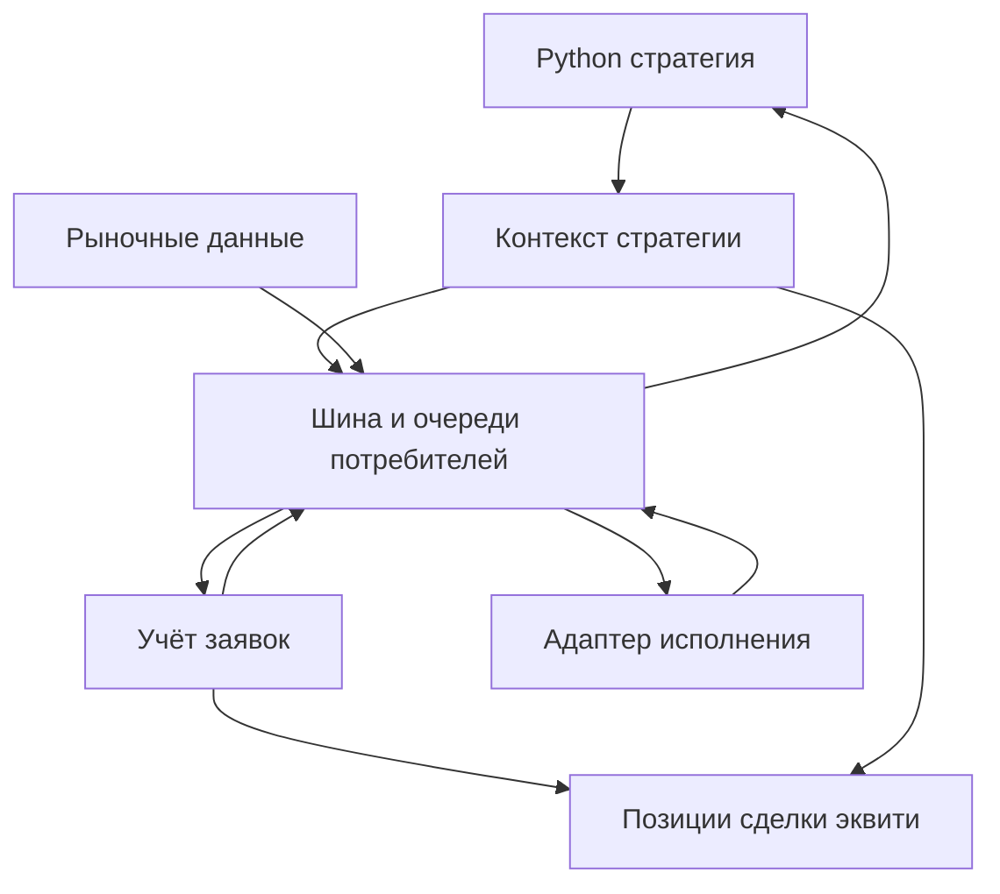
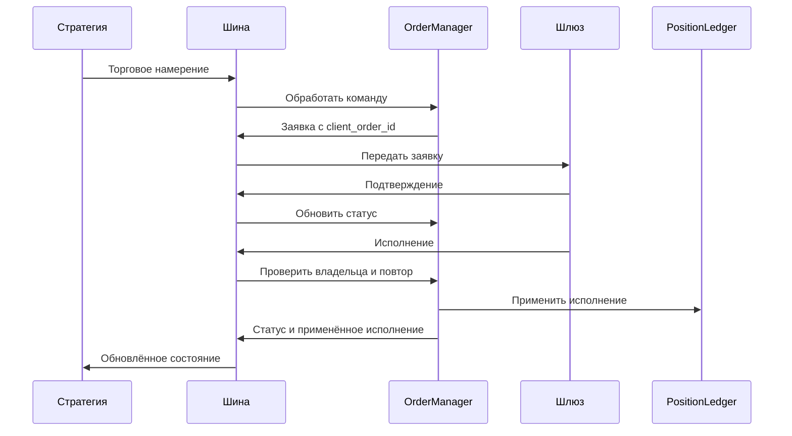
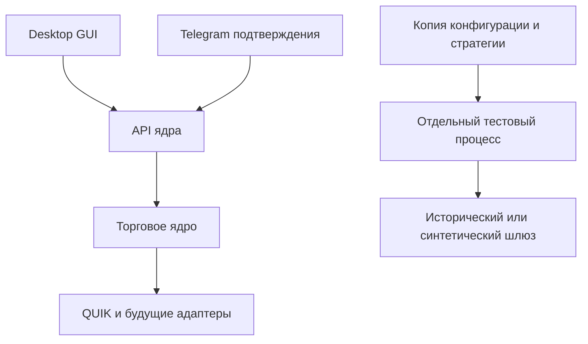

# Архитектурный эскиз TradingSystem v2

Согласовано 6 октября 2026 года, уточнено по ответам Q1–Q4 8 октября. Это исходные границы для разработки через XP и TDD. Детали уточняются тестами и рефакторингом по мере реализации итераций.

## Границы первой итерации

Первая итерация реализует один сквозной сценарий без подключения к брокеру: Python-стратегия получает завершённую свечу, создаёт торговое намерение, симулятор подтверждает заявку и передаёт управляемое исполнение. Учёт обновляет виртуальную позицию. После полного завершения торгового цикла появляется новая точка закрытой эквити.

В первой итерации исполнение симулятора задаётся тестом или демонстрацией вручную. Это проверка цепочки учёта, а не историческая модель исполнения. Исторический шлюз с правилами следующего бара появится на этапе 4. Изоляция тяжёлых вычислений, конечные очереди, сохранение, отмена, стопы и восстановление ещё не реализуются; первая итерация не предназначена для live.

Во [второй итерации](iteration-02.md) добавлены лимитная цена, отмена и последовательная замена, отказы и терминальные состояния. Исполнения продолжают управляться сценарием; исторического исполнения и live-подключения пока нет. Подтверждение отмены несёт окончательное исполненное количество; новая заявка ждёт учёта всех соответствующих fills. Маршрут и сторона замены сохраняются, объём рассчитывается как её целевой суммарный объём минус исполненный объём старой заявки.

## Компоненты и владельцы состояния

Стратегия получает данные и создаёт намерения через контекст. Контекст связывает её идентичность с командами, предоставляет модельное время и неизменяемые представления её собственного состояния. Стратегия не получает объект шлюза или глобальную шину.

OrderManager назначает клиентские идентификаторы, проверяет намерения, владеет заявками и связывает исполнения с владельцем. PositionLedger владеет виртуальными позициями, закрытыми сделками и эквити. Эти данные не пересчитываются независимо в стратегии.

EventBus доставляет типизированные сообщения по именованным очередям. Один потребитель обрабатывает свою очередь последовательно. Публикация помещает сообщение в очередь и не ждёт callback. Ошибки обработчиков доступны вызывающему коду при ожидании завершения обработки; они не прекращают обслуживание остальных очередей. В первой итерации очереди не ограничены; приоритеты и перегрузка появятся отдельно. Длительный синхронный Python-код пока способен задержать event loop, поэтому изоляция ML-расчётов остаётся будущей задачей.

Адаптер получает команду отправки через собственную очередь, подтверждения и исполнения возвращает событиями. Clock инъецируется; расчёт состояния не использует системное время напрямую.

## Исполнение и обновление состояния

Размещение намерения и подтверждение заявки не меняют позицию. Только валидное исполнение меняет количество, среднюю стоимость и реализованный результат. Повтор того же execution_id не применяется снова; повтор с другим содержимым считается ошибкой. Идентификатор исполнения рассматривается в пространстве его gateway_id.

Первый учёт использует average-cost и абсолютный P&L в одной отчётной валюте RUB. Множитель контракта применяется к ценовой разнице. Суммирование результатов разных валют без FX-преобразования отклоняется. FX-сервис появится до многовалютного распределения капитала.

При частичном закрытии реализованный P&L накапливается в текущей сделке, но closed-equity ещё не меняется. Цикл завершается, когда все позиции стратегии становятся нулевыми. Переворот закрывает прежний цикл и начинает следующий, если после закрываемой части все ноги flat; при другой открытой ноге общий цикл продолжается. Комиссия исполнения распределяется между закрытой и открытой частью пропорционально количеству. История сохраняется отдельно от вычислительного состояния стратегии на этапе persistence.

## Процессы целевой системы

GUI и ядро независимы. Бэктест получает копию конфигурации и код стратегии, собственное хранилище и окружение, без объектов live-шлюзов. API подтверждения общий для GUI и удалённого клиента. Самостоятельный IPC и удалённый клиент не входят в первую итерацию.

## Зафиксированные правила для следующих итераций

- Desired leverage — положительный модификатор веса: `effective_weight[i] = weight[i] * desired[i] / sum(weight * desired)`. Вес служебной ручной стратегии равен нулю. Её уже открытые позиции учитываются в ограничениях счета.
- Максимальное плечо задаётся на счёт. Ёмкость счёта определяется его средствами и максимальным плечом. Пропорции ног ограничивают доступный масштаб корзины. При распределении сначала рассматриваются стратегии с большим числом счетов, затем с большим эффективным весом; детерминированный tie-break задаётся идентификатором.
- Освободившиеся остатки перераспределяются повторными проходами. Занятый позициями и активными заявками ресурс не изымается при плановом перерасчёте. Резерв не является весом стратегии.
- При внешнем дефиците после оповещения и пользовательского таймера сокращаются связанные с дефицитным счётом позиции, начиная с наибольшего абсолютного количества лотов. Для корзины применяется единый коэффициент сокращения, сохраняющий пропорции ног в общей валюте; сокращение прекращается после устранения дефицита с учётом дискретности лотов. Сравнение лотов — выбранная пользователем политика, а не оценка экономического размера позиции.
- Общая защита корзины использует совокупный P&L. Стандартная защита ставится на фактически исполненное количество, включая незавершённую часть входа. Сложная логика может принадлежать стратегии.
- Замена заявки сначала подтверждает отмену старой и учитывает её исполнения, затем отправляет новую на актуальный остаток. Перекрытие заявок отложено.
- В бэктесте совпадающие события идут в порядке исполнения/обновления ордера, свечи, таймера. Новая заявка не исполняется по уже полученному бару. Лимит исполняется по своей действующей цене при допустимых условиях. Модель частых перестановок и Монте-Карло исследуются отдельно; исполнения стопов на баре активации исключаются.
- Синтетические live-свечи используют last; при его отсутствии допустим mid. История заполняется предыдущим close, отсутствие начальной цены является ошибкой. Новая свеча и коррекция имеют разные обработчики.
- Обновление стратегии выполняется после закрытия позиций либо после явно подтверждённой передачи позиций и связанных ордеров служебной ручной стратегии. Эквити не удаляется со сброшенными индикаторами.
- Первые production-настройки предусматривают QUIK для фьючерсов, таймаут подтверждения/отмены 90 секунд, stale candles по таймфрейму с учётом календаря. GUI сохраняет конфигурацию представлений; восстановление открытых окон необязательно.

Точные сигнатуры будущих менеджеров и transport выбираются по работающим сценариям. Пустые реализации всех запланированных классов заранее не создаются.

## Уточнение lifecycle и владения — 8 октября

Ручная стратегия учитывает все внешние заявки и позиции, не принадлежащие отслеживаемым стратегиям, после системной сверки. Она не размещает новые заявки по ручному вводу из GUI. Предусмотрены закрытие и передача позиций другим стратегиям, в том числе частями; перенос владения не меняет канонические исполнения и не создаёт рыночного P&L.

Многоногая стратегия декларирует политику сбоя ноги: защита, достроение либо закрытие. Аварийный контроллер исполняет выбранный сценарий, оповещает оператора и приостанавливает обычную торговую логику. Правило внешнего дефицита с сохранением пропорций применяется отдельно.

`OPTIMIZING` — состояние стратегии, а не глобальная остановка ядра. Оно блокирует доставку рыночных событий и новые торговые решения этой стратегии. Явный запрос большого объёма истории разрешён; вычисление выполняется вне торгового event loop. Учёт и защита существующих исполнений продолжаются. Успешное окончание снимает статус; ошибка требует обработки без автоматического возобновления торговли. Подписки других стратегий работают независимо. В итерации 4 реализованы pause/resume, `OPTIMIZING`, исторический snapshot-контракт и отдельный CPU-worker; полный lifecycle, реальный источник истории и stop/flatten впереди.

Портфельный бэктест остаётся следующим расширением одиночного движка. Отдельная платформа параллельной оптимизации не является условием приёмки первой версии.

## Реализованный срез lifecycle — итерация 4

Статус стратегии и готовность OMS — независимые барьеры. В `RUNNING` новые решения разрешены только при готовом хранилище и сверенном шлюзе. `PAUSED`, `OPTIMIZING`, `FAILED` блокируют свечи/place/replace, сохраняя финансовый учёт и отмены. Блокировка отдельного runner сериализует callbacks и применение результата, а историческая загрузка и CPU-расчёт идут вне неё. Worker получает копии данных; его старое состояние не перезаписывает fills, пришедшие во время расчёта.

Общий журнал сохраняет закрытые схемы OMS и отдельные версии checkpoints стратегии. Восстановление не отправляет старые команды и не повторяет callbacks. Явные state hooks принадлежат автору, финансовая история — ledger. Сохранённый `OPTIMIZING` становится `PAUSED`; успешный расчёт возвращает прежний режим, включая явную паузу оператора. Отмена и результат сверяются с текущей задачей; runtime владеет всеми созданными задачами до окончания их очистки.

Контракты, API и оставшиеся границы находятся в [отчёте итерации 4](iteration-04.md). Этот срез расширен итерацией 5: market data и первоначальная историческая модель с прогревом.

## Реализованный срез данных и исследования — итерация 5

CandleBook владеет общей завершённой историей и отличает повтор/коррекцию от нового бара. Контекст предоставляет load_history с отсечением по модельному времени; автор прогревает вычисления в on_start/on_restore. Коррекция идёт в отдельный on_correction без повторного торгового candle callback и финансового переисполнения. Фильтры таймфреймов исполняются внутри runner, сохраняя изоляцию ошибок стратегий.

Явный календарный список задаёт ожидаемые интервалы; fill_gaps использует предыдущий close или начальный seed. HistoricalGateway исполняет только на реальных барах: market BUY/SELL по High/Low, limit по действующей лимитной цене. Исполнения и их callbacks завершаются до candle callback; заявки из них ждут следующего бара.

SingleBacktest создаёт собственные runtime/шлюз/часы/историю для одной стратегии, инструмента и таймфрейма. Общий ledger остаётся владельцем финансов. Финальная оценка открытых позиций по последнему close отделена от закрытой эквити; конец данных не создаёт fill. Расписание OPTIMIZING в бэктесте отключено до модели его времени. Отдельный исследовательский процесс, реальные источники/календарь, stale-таймеры и портфельный запуск впереди. [Полный контракт](iteration-05.md).

## Промежуточная проверка и первый срез капитала — итерация 6

[Проверка](midpoint-review.md) подтвердила владельцев состояния и выявила два дефекта: остановку очереди при CancelledError из callback и отсутствие блокировки записи после конфликта retry_projection. Оба исправлены регрессиями; FAILED не прекращает финансовую доставку.

`allocate_capital` — чистый планировщик поверх явных снимков AccountCapital/CapitalUsage, StrategyCapital и FxSnapshot. Он не владеет финансовыми позициями и не является резервом OMS. Денежный резерв вычитается из equity до плеча счёта; модификатор desired_leverage нормирует только вес. Занятые позиции/заявки, включая manual/external, служат неизымаемой нижней границей.

В каждом проходе свободная ёмкость счёта делится по модифицированным весам способных использовать её стратегий; корзина получает общий целый масштаб по фиксированным маршрутам. Приоритет: число счетов, вес, ID. Остатки проходят следующий расчёт; дефициты возвращаются явно. Это детерминированный алгоритм с локальными проходами, без глобальной оптимизации маршрутов. FX применяется к планированию; RUB-ledger не объявляется многовалютным.

Полный контракт, числовой пример и границы — в [итерации 6](iteration-06.md). План нельзя использовать как уже зарезервированный ресурс; допуск конкретных намерений выполняет OMS по отдельной политике.

## Уточнение этапа 5 после итерации 7

OMS владеет политикой допуска и атомарным переходом заявки вместе с ledger. Политика оператора задаёт точные маршруты, абсолютные лимиты счетов/стратегий, оценку инструмента и TTL. Финансовая позиция остаётся в ledger; резерв выводится из наибольшей возможной экспозиции при частичных исполнениях активных заявок и ожидающих замен. Разные владельцы и маршруты не неттируются.

Команда сначала рассчитывается в изолированном состоянии, фиксируется в журнале и лишь затем отправляется шлюзу. Сбой доставки после commit требует перезапуска/сверки. Формат OMS v2 сохраняет состояние допуска при переходе; v1 остаётся читаемым. После восстановления новой торговли нет до сверки и новой действующей политики.

Рабочий срез использует RUB и лимитные намерения. Полученный корректный fill выше оценки учитывается, повышает оценку и может дать дефицит. При дефиците/просрочке доступен ограниченный выход, не допускающий повторного расходования объёма закрываемой позиции. Полный контракт, различие оценки и брокерской маржи, границы доверенного Python-кода — в [итерации 7](iteration-07.md).

## Источники и пересчёт после итерации 8

CapitalSource поставляет полный пакет CapitalSnapshot с source_id/sequence и сроком действия; CapitalTarget описывает веса и пропорции без собственной оценочной цены. Runtime загружает пакет вне блокировки OMS, затем под той же границей атомарности рассчитывает план по текущим позициям и активным заявкам. Expected revision защищает от запоздавшего ответа после другой настройки. Sequence и as_of защищают от отката источника; реальную согласованность нескольких брокерских API должен обеспечить будущий адаптер.

Бюджет владельца/счёта равен занятой части плюс дополнительным выделениям. Не включённый в targets владелец сохраняет занятую часть без новых маршрутных разрешений. Внешний ресурс пока вводится отдельно как неучтённая OMS денежная занятость; это не импорт позиций. Replay восстанавливает последний пакет и план без обращения к источнику. Подробнее — [итерация 8](iteration-08.md).

## Ручной владелец и сверка — итерация 9

`InventoryReport` — доверенная операторская команда со снимком заявок, нетто-позиций, исторических ID исполнений и явными неучтёнными остатками/себестоимостью. OMS сверяет весь шлюз и фиксирует импорт атомарно с ledger. `manual` — зарезервированный служебный получатель финансовых событий, без market callbacks и свободного SubmitOrder. Его вес нулевой, занятая ёмкость реальна.

`TransferPosition` меняет владельца и себестоимость количества, оставляя уже начисленный P&L у источника. Runtime проверяет паузу обоих runners, OMS — revision, маршрут и отсутствие активных заявок/барьеров. Уведомление `PositionChanged` отделено от fill. Циклы, затронутые изменением владения, завершаются в `OwnershipSettlement` и эквити, а не в статистике обычных round-trip Trade. `CloseManual` создаёт только ограниченный лимитный выход через общий OMS.

Импорт/передача требуют нового расчёта капитала. Inventory-шлюз после restart нельзя разблокировать одной сверкой заявок: нужен отчёт позиций и новая политика. Исторические fills не применяются повторно; неизвестное исполнение не позже временной границы требует разрешения источником. Реальный адаптер и брокерский watermark остаются этапом 7. [Полный контракт и пример](iteration-09.md).

## Групповые планы и аварийная политика — итерация 10

PlanBook — часть кандидата и commit OrderManager, без собственного финансового ledger или отдельного журнала. TradePlan задаёт фиксированные лимитные ноги, сроки, общий stop_loss и FailurePolicy. Все намерения проходят допуск в одном финансовом состоянии до отправки; сетевой fan-out и брокерские fills остаются отдельными событиями. Один активный план владеет полным циклом стратегии из flat, блокируя индивидуальные submit/replace и передачу владения.

При отказе ноги OMS сразу сохраняет блокировку решений и PlanAlert; runtime ставит PAUSED и отменяет OPTIMIZING, а финансовый протокол и аварийное действие продолжаются. PROTECT удерживает исполненное под локальным совокупным P&L-стопом, COMPLETE один раз достраивает остаток, CLOSE ограниченно закрывает фактическое. Любое достроение/закрытие ждёт барьеров отмены. Ошибка выхода/отмены требует явного RetryPlan, устранённая авария — AcknowledgePlan и отдельного resume.

PlanMarks — явный полный пакет оценки с sequence/TTL; CheckPlanDeadlines — детерминированный tick по часам OMS. Живые источники, scheduler и нативные стопы здесь не реализованы. Replay восстанавливает план/alerts/границы попыток без отправки прошлых команд; новое действие ждёт сверки шлюзов и капитала. [Подробности и ограничения](iteration-10.md).

## Сокращение внешнего дефицита — итерация 11

DeficitBook хранится внутри того же перехода OMS, что PlanBook и ledger. StartDeficit захватывает группы позиций/заявок затронутого счёта и все ноги связанных активных планов. После оповещения/ожидания и барьеров отмены выбирается крупнейшая группа по количеству лотов. НОД целых шагов задаёт минимальный пропорциональный выход. Следующая группа создаётся только после исполнения предыдущей и нового расчёта дефицита.

Сохранённая ReductionTarget отличает повтор недоисполненного выхода от нового определения объёма. Частично исполненная корзина доводится до прежних остатков явной командой; неисполненная попытка пересчитывается по актуальному дефициту. Локальное защитное закрытие плана имеет приоритет. Риск-события независимо ставят стратегию на паузу и отменяют OPTIMIZING; callbacks не владеют финансовым процессом.

Команды входят в закрытый JSON-словарь журнала, снимки восстанавливаются детерминированно без повторной отправки. Один неподтверждённый процесс на OMS, общая RUB-оценка, явные цены и timer tick — границы этого среза. [Контракт и проверки](iteration-11.md).

## Локальные TP/trailing и изменение политики — итерация 12

Чистая evaluate_protection сравнивает точный совокупный P&L с SL, TP и границей trailing. PlanBook владеет действующей PlanProtection, максимумом и ProtectionTrigger; финансовые позиции по-прежнему принадлежат ledger. Максимум включает историю наблюдавшихся оценок исполненного объёма и не сбрасывается при частичном сокращении или изменении параметров. После запроса выхода причина фиксируется, повтор возможен только через прежний протокол RetryPlan.

Начальные TP/trailing входят в TradePlan. UpdatePlanProtection меняет действующую политику и при необходимости полный пакет лимитов, сохраняя исходную спецификацию для идентичности плана. Команда использует владельца, общую ревизию OMS и свежие marks; результат немедленно проходит через единый процесс отмены/выхода. Защита при дефиците, паузе, OPTIMIZING и сбое callback остаётся внутри OMS.

Закрытый codec допускает точную историческую форму TradePlan с двумя отсутствующими новыми полями; общий произвольный пропуск полей не разрешён. Снимки защиты выводятся replay из журнала. Локальная защита обычных одиночных/manual-позиций и подключение live-источников остаются следующими историями. [Подробности](iteration-12.md).

## Защита существующих позиций — итерация 13

TradePlan допускает одну или несколько ног. ProtectPositions подключает все завершённые по заявкам позиции владельца к существующему PlanBook: opening_positions и opening_pnl сохраняют количество, себестоимость и результат открытого цикла ledger. Входных заявок и синтетических fills нет. Общая evaluate_protection и прежний исполнитель ограниченных выходов обслуживают новый и подключённый план одинаково.

ReleasePositionProtection — операторское снятие только несработавшей подключённой защиты в спокойном OPEN. Терминальное RELEASED освобождает владение действиями, сохраняя финансовую позицию и историю. Передача/частичное закрытие выполняются отдельными прежними командами; после передачи нужна новая политика капитала и явное подключение новой защиты. Существующий TradePlan с собственными входами этим способом не снимается.

DeficitBook учитывает подключённую обычную группу как корзину, а manual-маршруты — независимо: совокупный P&L-stop не объявляет пропорций для внешних позиций. Активная manual-защита блокирует новые импорты и обход через CloseManual, но допускает сверку уже известных остатков. Новые команды используют прежний закрытый codec/транзакцию/replay; собственного финансового писателя нет. [Контракт](iteration-13.md), [границы завершённого этапа](stage-06-review.md).

## QUIK-контракт и неопределённые исходы — итерация 14

quik_contract переводит явно заданные SPBFUT-маршруты и сырые callback-поля в типизированные отчёты. QuikReplayGateway сериализует обработку, записывает структурированные транзакции, связывает TRANS_ID/локальный ID/номер брокера и публикует стандартные события OMS. Он не владеет финансовым ledger и не подключается к сети.

GatewayUncertain хранит в прежнем журнале блокировку сверки и необходимость нового капитала. Заявка остаётся с неизвестным исходом и занятым резервом; OnConnected не является сверкой. При restore сохраняется объединение известных блокировок и шлюзов финансовых объектов. Будущий live-транспорт обязан добавить durable-идентификаторы/связи и журнал сырых событий до отправки/доставки; память replay-адаптера для этого недостаточна. [Контракт](iteration-14.md).

## Журнал протокола QUIK — итерация 15

QuikDurableGateway оборачивает прежний протокол: отдельный DurableJournal хранит неизменяемый профиль сессии и пары input/result. Кандидат вычисляет соответствия, подготовленные транзакции и сообщения без EventBus; result сохраняется до принятия состояния и доставки в OMS. Сырые JSON-поля callbacks сохраняются до нормализации. Финансовый писатель по-прежнему один — OMS/ledger.

Восстановление проверяет производные результаты и достраивает единственный незавершённый input. TRANS_ID, request_id отмены, брокерские номера, дедупликация сделок и deadlines сохраняются. Финансовые сообщения доставляются повторно с прежними ID; новые подготовки после restart отсутствуют, gateway и OMS заблокированы до независимой сверки. Журналы OMS и шлюза раздельны; закрытый/повреждённый журнал или потеря доставки останавливают экземпляр. [Контракт и ограничения](iteration-15.md).

Транспортный outbox с отметкой попытки отправки, подтверждение сетевого состояния, read-only reconciliation и процедура возобновления ещё не реализованы. Свойство prepared — аудит сохранённой подготовки текущего процесса, не разрешение на отправку. Целевой первый контур — QUIK ПСБ.

## Диагностическое подключение QUIK — итерация 16

ReadOnlyQuik владеет двумя локальными TCP-сокетами и отдельным журналом wire. Запросы сериализованы; исходные кадры сохраняются до отправки/разбора, IDs ответа проверяются точно, очереди и объём записи ограничены. Любая неопределённость закрывает экземпляр без автоматического повторения. Python-клиент и Lua-wrapper независимо разрешают только чтение; runtime handshake проверяет профиль, QUIK и Lua.

quik_snapshot выполняет два последовательных чтения таблиц и отмечает изменения, смену даты и callbacks. quik_probe сохраняет отчёт в новый каталог. Это наблюдения терминала, а не подтверждённая проекция брокера: reconciled всегда false. Новые модули не подключены к OMS и QuikDurableGateway.feed, не создают торговые маршруты и не импортируют внешние позиции. Следующая граница — согласование снимка с потоком callbacks и финансовым учётом после проверки на демо. [Контракт](iteration-16.md), [первое подключение](quik-readonly-check.md).

## Финансовые параметры инструмента — итерация 17

quik_parameters — чистая проверка двух выборок getParamEx и справочника. Она отделяет lot_size от числа контрактов и точного отношения стоимости шага к шагу котировки. Исходные ответы сохраняются; неизвестные значения не получают числовых defaults. Валютная политика пока ограничена явными SUR/RUB, quantity multiplier=1 и целыми контрактами.

ReadOnlyQuik и Lua независимо ограничивают пять имён getParamEx; capability instrument_parameters_v1 защищает запуск нового режима со старой обёрткой. capture_snapshot включает параметры в два прохода и снимает расчётный кандидат при любой обнаруженной нестабильности. CLI выдаёт instrument.json без таблиц учёта. Связи с созданием Route, капиталом, OMS и разрешением торговли нет. [Контракт](iteration-17.md).

## Наблюдения фьючерсных лимитов — итерация 18

quik_limits — чистая проверка двух таблиц счетов и лимитов. Полный FuturesLimitKey отделяет фирму, счёт, тип и исходный код валюты. Инвентаризация не выбирает счёт; явный выбор требует единственной корректной строки в обоих проходах и отсутствия проблем всего снимка. Суммы остаются наблюдениями, включая нули и отрицательные значения. Капиталом и внешним дефицитом по-прежнему владеет OMS через отдельные контракты.

capture_snapshot повторно использует существующие чтения без расширения протокола. Общая неподтверждённость снимает и выбранное наблюдение лимита, и финансовый кандидат. CLI разделяет нормализованные данные с условными именами (limits.json) и локальную расшифровку полных ключей. Следующая граница — подтверждённое преобразование счёта в источник капитала и согласование снимков/callbacks с OMS; текущий отчёт этих команд не создаёт. [Контракт](iteration-18.md).

## Отдельная оценка ресурса QUIK — итерация 19

`quik_capital.assess_futures_resource` — чистая функция над полным read-only снимком, `FuturesResourcePolicy`, временем оценки и явным набором `LocalMarginReservation`. Она повторно проверяет сырые таблицы и точный выбор, возвращает брокерский свободный ресурс CBPLPLANNED и расчётный остаток после только неотправленных локальных резервов. Это отдельная денежная величина, не `AccountCapital.equity`, не `CapitalUsage` и не `admission.CapitalPolicy`.

Состояние возможной отправки требует независимой сверки и блокирует расчёт остатка. Функция не освобождает резервы, не меняет OMS, не формирует заявки и не становится источником торгового допуска. Полнота локальных обязательств остаётся обязанностью вызывающего кода до появления адаптера, связанного с подтверждённой границей снимков/callbacks. Контракт, формула, источники и ограничения описаны в [итерации 19](iteration-19.md).

## Граница доставки callbacks — итерация 20

Lua-wrapper присваивает каждому разрешённому callback номер в пределах экземпляра скрипта. Команда `tsCallbackCursor` читает курсор по каналу запросов; callback-сокет сохраняет единственного писателя. `quik_boundary.CallbackTracker` проверяет метаданные, а `ReadOnlyQuik.callback_fence` ждёт записи кадров до указанного номера в wire-журнал. Область подтверждения начинается с курсора runtime handshake и не включает предшествующую историю.

`capture_snapshot(require_callback_fence=True)` ставит границы до и после двух чтений. Активность между курсорами снимает повторяемость даже при одинаковых таблицах. CLI `--callback-fence` выдаёт отдельный `boundary.json` без таблиц счетов и сумм. При ошибке доставки соединение закрывается; при старом wrapper новый режим явно отклоняется.

Этот слой доказывает только доставку наблюдателю в пределах своего протокола. Он не задаёт атомарную границу брокерского состояния, не дедуплицирует финансовые исполнения и не вызывает OMS. Подробности — [итерация 20](iteration-20.md), последующее сравнение и применение — [контракт сверки](quik-reconciliation-contract.md).

## Независимое сравнение с OMS — итерация 21

quik_compare нормализует полный read-only снимок по явной ComparisonPolicy и возвращает неизменяемые наблюдения. Маршрут связывает фирму, точный счёт, SPBFUT-инструмент и выбранный тип позиции. Цены и комиссии сохраняют Decimal; неизвестные данные и конфликтующие дубли не получают defaults. Валидность кэшированных признаков снимка повторно проверяется по исходным таблицам, времени и курсорам.

OrderManager.observe_gateway копирует весь финансовый учёт gateway на одном revision без await. QuikDurableGateway.comparison_bindings экспортирует сохранённые связи номеров с локальными ID и версию протокола. compare_quik принимает обе неизменяемые проекции и текущую revision OMS, сравнивает заявки, исполнения и сумму позиций всех владельцев. Он не формирует InventoryReport, не вызывает обработчики и не меняет журнал. consistent означает совпадение наблюдений; границы полноты истории и атомарности остаются неподтверждёнными. [Контракт, API и ограничения](iteration-21.md).

## Применение сохранённых исполнений — итерация 22

`quik_repair` строит неизменяемый `RepairExecutions` по заново проверенному наблюдению, проекции OMS и `ExecutionEvidence` durable-шлюза. Payloads сохраняют порядок фиксации; допускается только пропущенный конец истории. Digest служит аудитом, не подписью брокера. Команда содержит revision обеих сторон, ограниченный срок, целевые количества заявок и совокупные позиции.

`QuikDurableGateway.apply_execution_repair` проверяет актуальный источник под блокировкой шлюза и передаёт команду в защищённый переход OMS. Прямой публичный handle отклоняет repair. OMS выполняет fills на копии, проверяет итог, записывает один пакет и только затем принимает состояние/публикует уведомления. Replay использует сохранённые факты и ID операции. Блокировки торговли и требование свежего капитала сохраняются; планы/дефициты/отмены не продвигаются этим переходом. [Контракт и границы истории](iteration-22.md).

## Разрешение исходов заявок — итерация 23

`quik_outcomes` сопоставляет сохранённые сообщения регистрации/отмены и их отказов с текущим наблюдением. `OrderEvidence` воспроизводится из durable-протокола, включает доказательства исполнений и привязан к revision источника. Команда `ResolveOrders` содержит точные целевые состояния и явный список отказов от ожидающих замен; отсутствие строки заявки не становится доказательством отказа.

`QuikDurableGateway.apply_order_resolution` использует защищённый журналируемый переход OMS. Все fills должны быть уже учтены, цели проверяются на копии до commit. Отмена не выпускает замену: для ожидающего намерения требуется явный отказ. Повтор и restart сохраняют исходы, позиции и блокировку торговли. Подробности и границы — [итерация 23](iteration-23.md).

## План внешнего учёта — итерация 24

`quik_inventory` строит `StageExternalInventory` из наблюдения, неизменяемого OMS, доказательств шлюза и явных деклараций происхождения. Нетто брокера сравнивается с суммой всех владельцев; стоимость внешнего остатка задаётся отдельно, будущий владелец всегда `manual`. Неучтённые исполнения известных заявок не становятся внешними.

`stage_external_inventory` повторно строит план под блокировками источника и OMS и записывает решение одним переходом. Отдельный признак ожидающего внешнего учёта переживает restart и не снимается обычной сверкой заявок/капиталом или прежним `InventoryReport`. Финансовый ledger и брокерские связи не меняются. Согласованный cutover обоих журналов остаётся следующим шагом; в этом срезе нет снятия блокировки. [API и границы](iteration-24.md).
